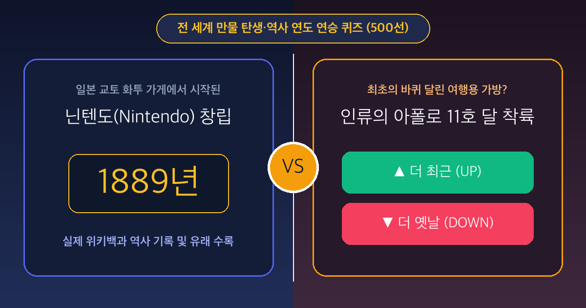

# ⏳ 타임 업 앤 다운 (TIME UP OR DOWN)

> **전 세계 만물 탄생·역사 연도 439선 연승 퀴즈 게임**  
> 👉 **지금 바로 플레이하기**: **[https://jub27.github.io/time-up-or-down/](https://jub27.github.io/time-up-or-down/)**

## 🎮 게임 소개
- **439개의 세계적인 아이템**: 구텐베르크 성경, 모나리자, 타지마할, 전화기·전구·비행기 발명, 에펠탑, 코카콜라, 닌텐도, 타이타닉호, 레고, 아폴로 11호 달 착륙, 아이폰, 비트코인, 챗GPT 등 전 세계인이 아는 역사·발명품·브랜드·명작 439선 수록
- **스마트 연도 매칭**: 동시대(1~15년 차이)의 헷갈리는 라이벌 매치와 세대·세기를 넘나드는 타임워프 매치의 조화
- **정보·유래·근거·출처 제공**: 매 라운드 정답 공개 시 위키백과 실시간 요약 및 역사적 기록 근거와 원문 출처 링크 제공
- **4개 국어 지원**: 한국어(`KO`), 영어(`EN`), 일본어(`JA`), 중국어(`ZH`)
- **친구 도전장 공유**: `?target=연승기록` 링크 공유를 통해 친구와 연승 기록 대결 가능
